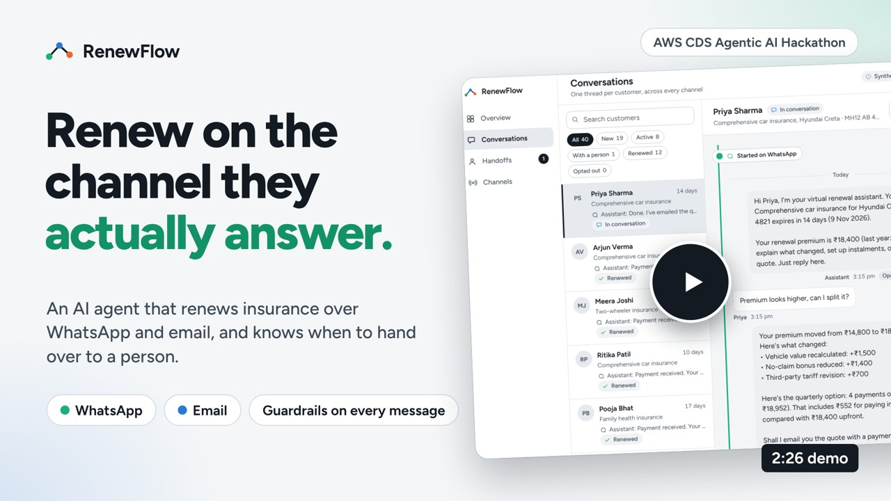
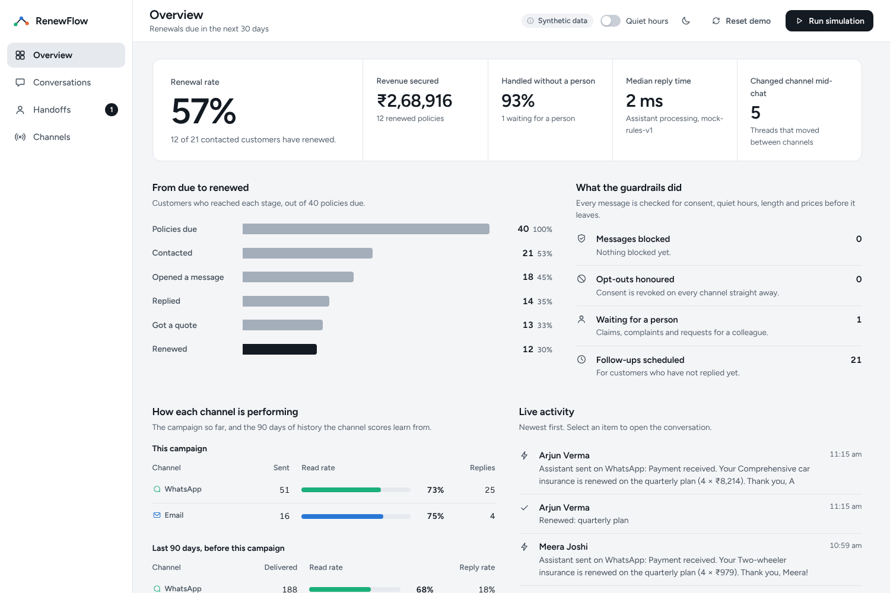
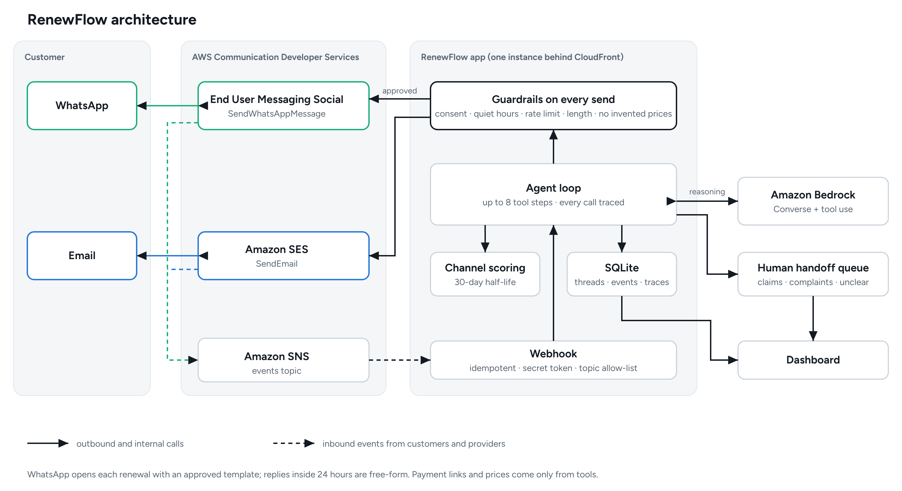

# RenewFlow

An omnichannel, agentic assistant for insurance renewals, built for the AWS Communication
Developer Services (CDS) Agentic AI Partner Hackathon.

RenewFlow starts each renewal on the channel the customer is most likely to answer (WhatsApp or
email), explains why the premium changed, prices payment options, sends a payment link, and moves
to another channel mid-conversation without losing context. It hands claims, complaints and
anything unclear to a person, honours STOP immediately, and shows everything on a dashboard.

**Demo video (2:29, with voice-over and subtitles):** [docs/demo/renewflow-demo.mp4](docs/demo/renewflow-demo.mp4)

[](docs/demo/renewflow-demo.mp4)



## Try it in two minutes

You need Python 3.11 or newer. No AWS account, keys or network access are required.

```bash
git clone https://github.com/Jehal05/AWS.git && cd AWS
pip install -e ".[dev]"
python -m renewflow --reset          # open http://localhost:8000
```

1. Open **Conversations**. **Priya Sharma** is selected.
2. Press **Start renewal**. The agent picks WhatsApp because that is where she engages, and sends.
3. Open **Play as customer** and tap *Premium looks higher, can I split it?*. The agent explains the
   increase and prices a quarterly plan.
4. Tap *Please email me the details*. The same thread continues on email (see the "Continued on
   Email" marker). Open the email, press **Renew securely**, then **Pay now**.
5. Pick another customer, start their renewal, and send *My claim was rejected*. They land in
   **Handoffs** and the assistant goes quiet. Send *STOP* on a third customer to see consent revoked.
6. Press **Run simulation** to push 20 synthetic customers through the same agent, then open
   **Overview** and **Channels**.

Run `pytest` for the 63 tests (a browser test replays this whole story).

Everything is synthetic, and in this mode WhatsApp and email are simulated in-process. The
dashboard labels each channel "(simulated)" or "(live)" so the two are never confused.

## How it uses AWS Communication Developer Services

| Piece | Local | AWS |
|---|---|---|
| WhatsApp | `LocalChannel` | End User Messaging Social `SendWhatsAppMessage` (`channels/aws.py`) |
| Email | `LocalChannel` | SES v2 `SendEmail` (`channels/aws.py`) |
| Model | rule-based mock using the same tool-calling protocol | Bedrock Converse with tool use (`llm/bedrock.py`) |
| Inbound replies and receipts | dashboard simulator | SNS → webhook (`aws/events.py`, `api/webhooks.py`) |

Channels and the model sit behind small interfaces, so the same agent runs in both modes. The AWS
adapters are tested against botocore's real request and response schemas. **They have not yet been
exercised against a live AWS account**: that needs Bedrock model access, SES production sending and
a Meta-approved WhatsApp number. Deployment (CDK, about $10 for two weeks, with a $10 budget alert)
is described in [docs/DEPLOY.md](docs/DEPLOY.md).



## What makes it safe to run on real customers

- Consent and enabled-channel checks on every send
- Quiet hours in the customer's time zone (21:00 to 08:00) and a limit of 2 proactive messages a day
- Per-channel length limits and blocked promises
- **No invented prices:** every ₹ amount in a message must come from a pricing tool, or the send is blocked
- STOP and START are handled before the model runs
- Claims, complaints and unclear requests go to a person with a summary; model or tool failures
  also end in a handoff rather than a silent drop
- Every tool call is traced and visible in the dashboard's Activity tab

## Layout

```
src/renewflow/
  agent/       tool-calling loop (max 8 steps), guardrails, tools, prompts
  analytics/   channel scoring (30-day half-life, Bayesian smoothing) and KPIs
  channels/    Channel protocol, local and AWS adapters
  llm/         ChatModel protocol, mock and Bedrock adapters
  aws/         inbound WhatsApp and SES event processing
  api/         FastAPI app and SNS webhook
  static/      dependency-free dashboard
infra/         CDK stack      docs/   architecture, deployment, demo script, Devpost text
tests/         63 tests
```

## Limits

SQLite on one instance is deliberate for a demo, not for production. The SNS webhook uses a secret
URL token and a topic allow-list but does not yet verify SNS signatures.

Licensed under MIT.
