# RenewFlow architecture

Every diagram below is Mermaid, which GitHub renders in the page. Each one describes what the code
in this repository does today. Where something is designed but not yet run on AWS, the diagram says so.

- [1. System context](#1-system-context)
- [2. Components](#2-components)
- [3. A renewal, end to end](#3-a-renewal-end-to-end)
- [4. Inbound message handling](#4-inbound-message-handling)
- [5. The agent loop](#5-the-agent-loop)
- [6. Guardrails](#6-guardrails)
- [7. Choosing a channel](#7-choosing-a-channel)
- [8. Conversation states](#8-conversation-states)
- [9. Events from AWS](#9-events-from-aws)
- [10. Data model](#10-data-model)
- [11. Deployment on AWS](#11-deployment-on-aws)
- [12. Local mode versus AWS mode](#12-local-mode-versus-aws-mode)

## 1. System context

Who talks to what. Solid arrows are implemented; the AWS side is tested against botocore schemas but
has not yet run against a live account.

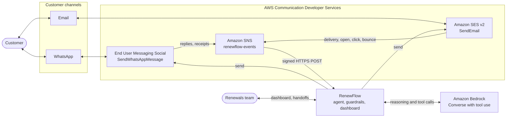

## 2. Components

The agent only ever sees two small interfaces, `Channel` and `ChatModel`. That is what lets the same
code run locally with a simulator and on AWS with the real services.

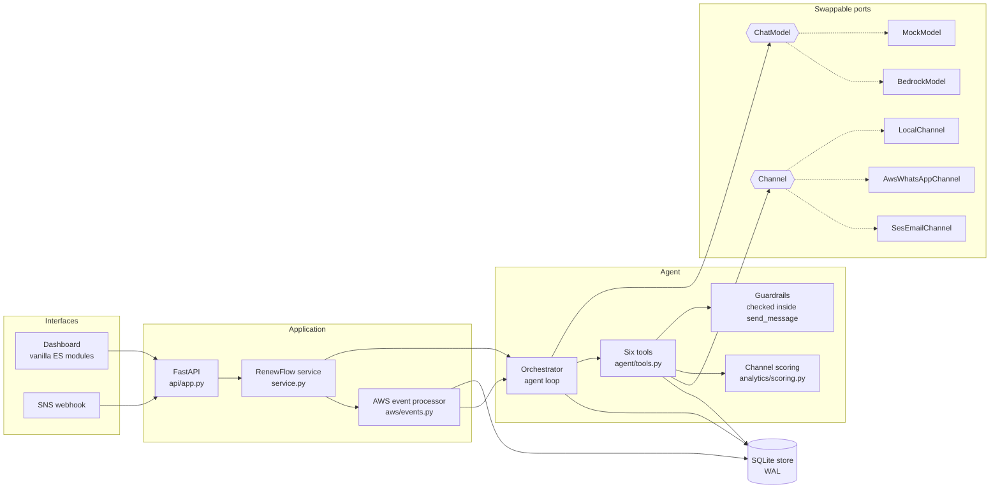

## 3. A renewal, end to end

The demo story with Priya Sharma: the agent opens on WhatsApp, explains the premium, moves the same
conversation to email and she pays.

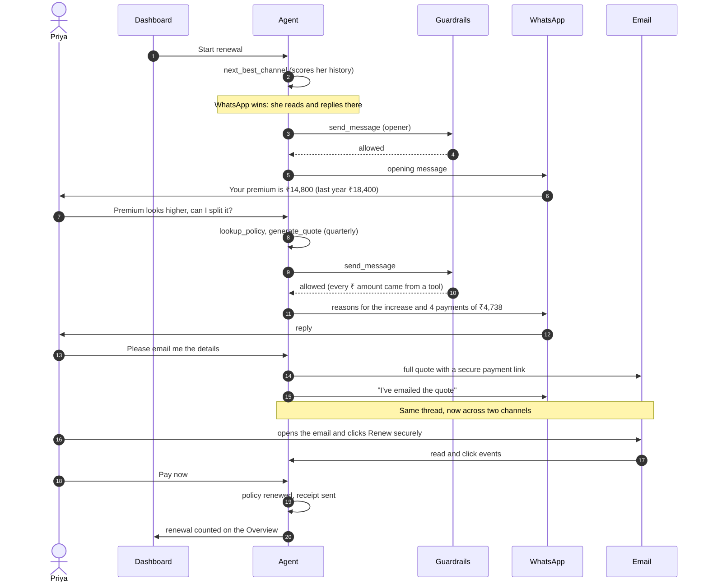

## 4. Inbound message handling

Compliance rules run before the model does. STOP is never left to a model to interpret.

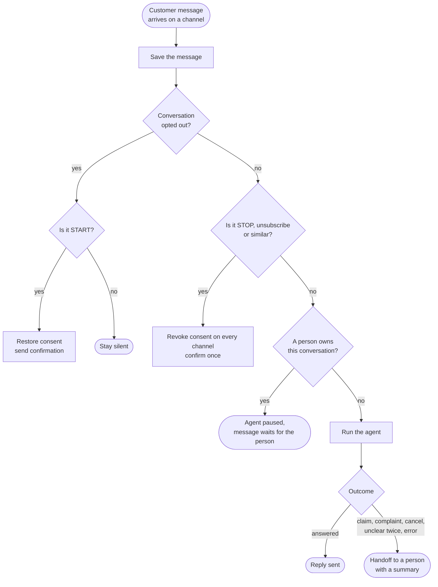

## 5. The agent loop

At most 8 model calls per run. Any model or tool failure ends in a handoff rather than silence.

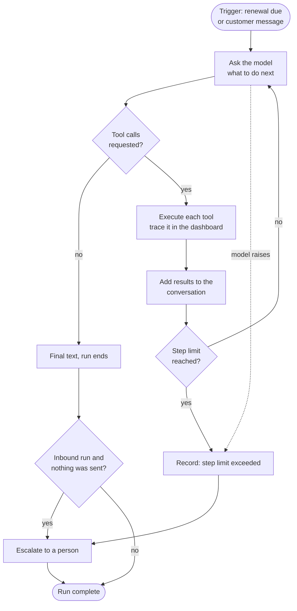

The six tools are `lookup_policy`, `generate_quote`, `next_best_channel`, `send_message`,
`schedule_followup` and `handoff_to_human`. Each call and its result is stored and shown in the
conversation's Activity tab.

## 6. Guardrails

Every outbound message passes these checks in this order, and the first failure blocks the send and
is recorded. The model cannot skip them because they sit inside the `send_message` tool.

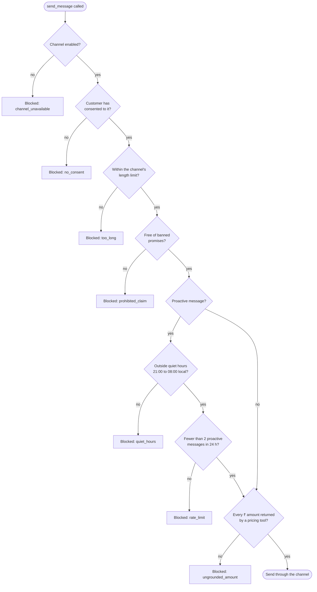

## 7. Choosing a channel

The score is computed from the customer's own history, weighted toward recent behaviour.

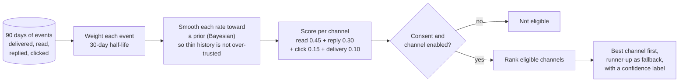

## 8. Conversation states

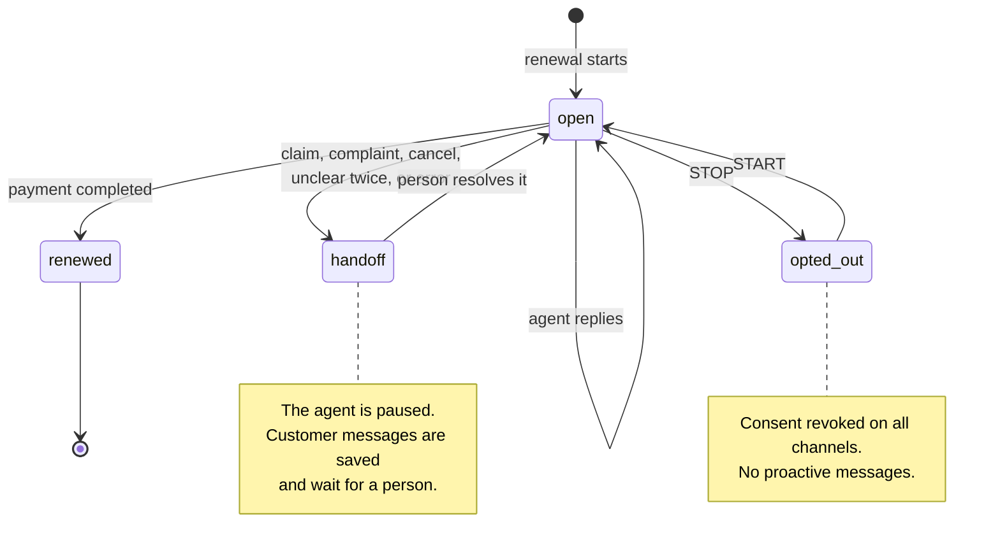

## 9. Events from AWS

How replies and delivery receipts get back into the conversation. The signature, the token, the
topic and the host of any subscribe URL are all checked before anything is processed.

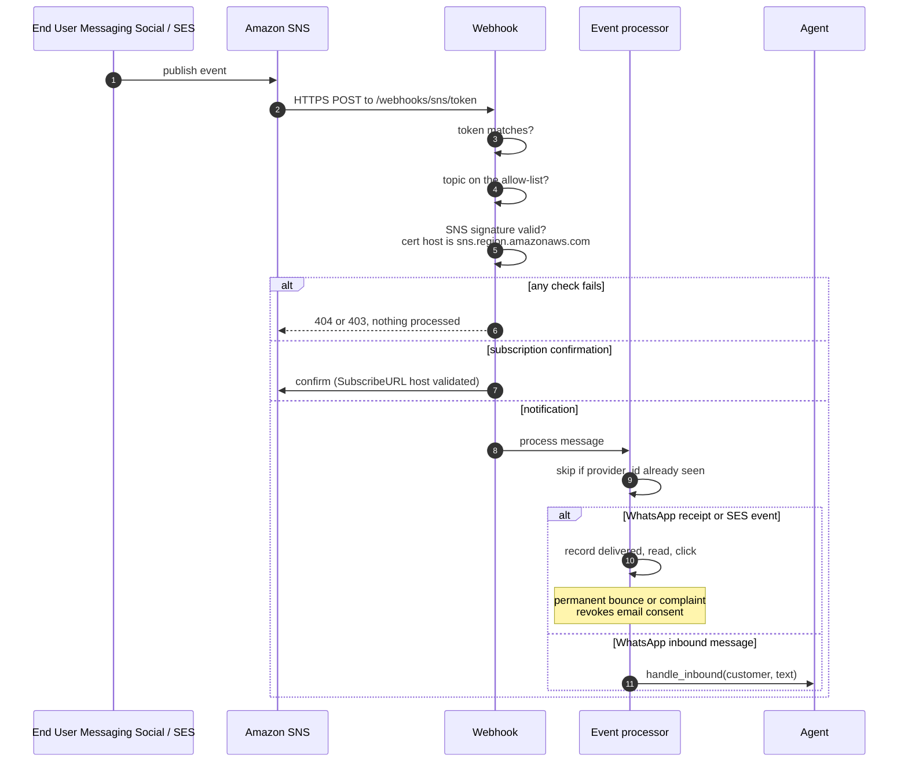

## 10. Data model

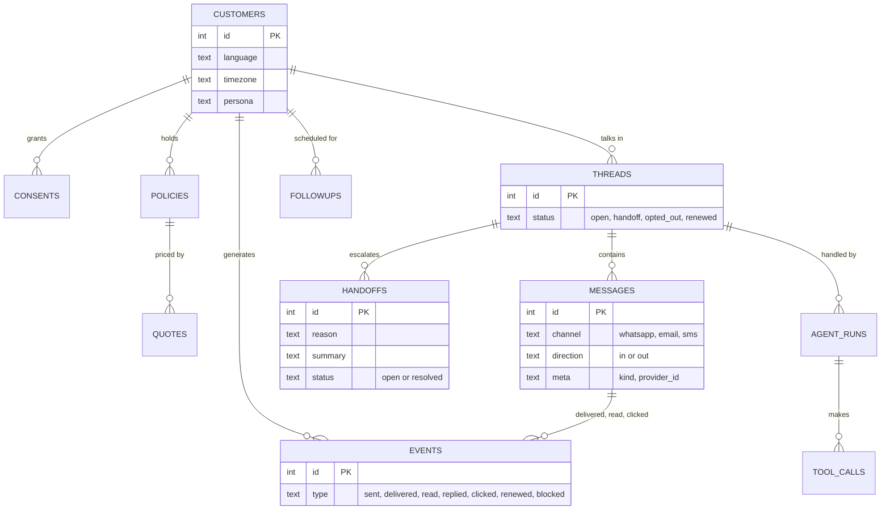

## 11. Deployment on AWS

Defined in [`infra/stack.py`](../infra/stack.py) with the CDK. It synthesises and its assertions pass,
but it **has not been deployed**; see [DEPLOY.md](DEPLOY.md). The design keeps cost near $10 for two
weeks: one small instance, no NAT gateway, no load balancer, and a budget alarm.

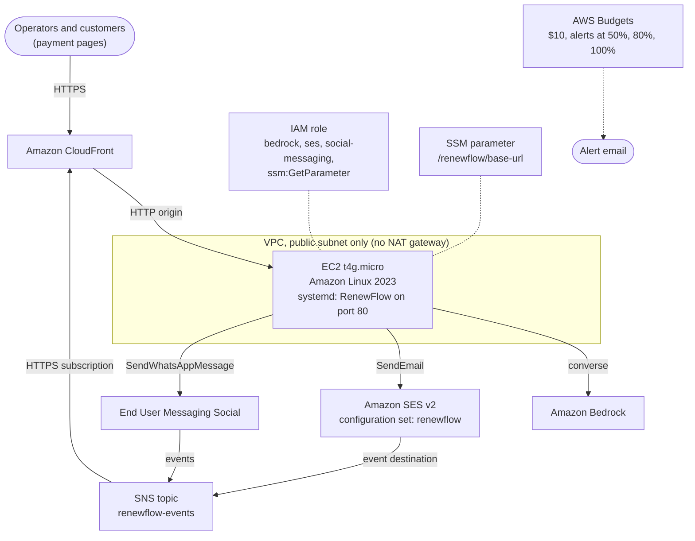

## 12. Local mode versus AWS mode

The same agent runs in both. The dashboard labels each channel "(simulated)" or "(live)" so the two
are never confused.

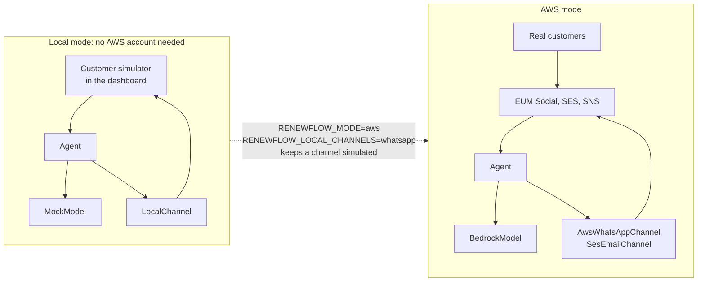
